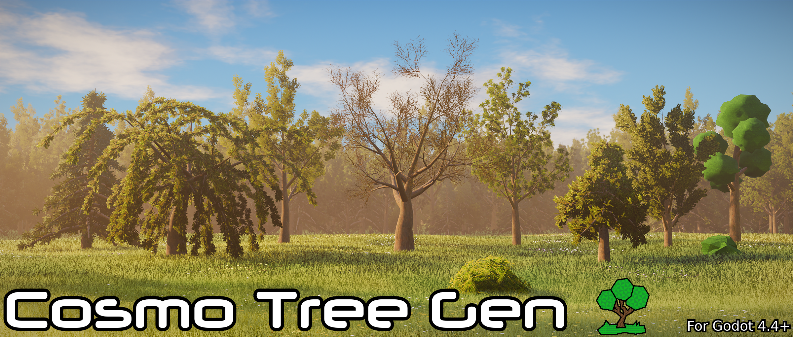

# Cosmo Tree Gen

Procedural tree generator for Godot 4. Create and tweak trees live in the editor, save them as presets, and export them to glb/glTF with LODs and collisions.

Mainly inspired by Dan Shiffman and EZTree.  

_100% Human made. No AI was or ever will be used in this project._  

## Features
- Live generation and auto-updated in the editor.
- Configurable tree parameters using custom Resources.
- Trunk and branches.
	- Multiple trunks per node, roots and broken branches by chance.
	- Branch level length and leaf card size by curve.
	- Optional flat shading for PSX/PS2 aesthetic.
- Foliage.
	- Icospheres, with configurable subdivisions level.
	- Card leaves, configurable amount and double sided, with canopy normals and inner AO.
	- Leaves shader with wind sway and limited mipmaps, so alpha scissor doesn't make distant leaves disappear.
- Automatic collision generation.
	- Three shape types: one convex shape per branch, one convex shape per branch segment, or a single trimesh.
	- Covers branches up to a configurable level (0 = trunk only).
	- Collision preview in the editor.
	- Foliage collision: hull (covers all the foliage), spheres on each leaf/branch end.
- Automatic LOD generation.
	- LOD0, LOD1 and LOD2 MeshInstance3Ds can be generated with customizable ratios and distances.
	- The trunk is simplified and the rest of the tris budget goes to the leaves.
	- Leaf cards are not simplified, fewer and bigger cards are kept instead.
- Presets.
	- 4 premade presets included (Ash, Bush, Low Poly Bush and Low Poly Tree)
	- 7 more premade presets can be found in the `demo` folder.
	- Can be saved as `CosmoTreePreset` resources.
- Export as glb/glTF with LODs and collisions, optionally linking the materials in the `.import` file.
- Exposed API for script generation, see [Batch Generation](docs/batch_generation.md).
- Editor toolbar: load/save presets, randomize seed, export, and it shows draw calls and tris counter per tree.

## Requirements
Godot 4.6+ required. Developed in 4.6.2.stable.  

## Installation
Copy the `addons/cosmo_tree_gen/` folder into your project, enable it.  
You can see more examples and presets in the `demo` folder.  

## Usage
1. Add a `CosmoTreeGen` node.
1. Pick a preset from the toolbar menu, or tweak `trunk_params` and `foliage_params` and add `CosmoBranchLevel`s to `branch_levels`.
1. Set bark and foliage materials, or use the ones in `addons/cosmo_tree_gen/materials`. Note: icosphere foliage needs a material with UV1 Triplanar.
1. Optionally, to generate collisions, set `collision_type` and `collision_level`, and optionally `collision_max_height` to cut it at a given height. Preview it toggling `preview_collision`.
1. Optionally, toggle `generate_lod` for LODs.
1. Tris budgets for LOD and distances can be configured in the project settings, see [Settings](docs/settings.md).
1. Can be used as is for quick prototyping or exported as glb/glTF from the toolbar.

## Documentation
Work in progress.
- [Getting Started](docs/getting_started.md)
- [Parameters](docs/parameters.md)
- [Settings](docs/settings.md)
- [Exporting](docs/exporting.md)
- [Batch Generation](docs/batch_generation.md)

## Showcase
  
Save and load presets fast.

  
Randomize by seed.

  
Live generation.

  
Curve editor for fine changes.

## Roadmap
By priority.

1. Billboard impostor PNG generation for the last LOD.
1. Add more low-poly foliage variations. (Pine, Boxes)
1. Add a tree age slider. From sapling to old tree.
1. Add min-max ranges to presets. It should define a species, from young to old.
1. Shadow proxy. Low poly mesh for foliage with `SHADOWS_ONLY`.
1. Bake tree in-place and make the node game-ready. So it can be used without extracting to `.glb`.
1. Hierarchical wind for trunk, branches and leaves.
1. Add stumps, fallen trunk and felled trees. From the same seed.
1. Add flowers, fruits and mushrooms/fungus on the trunk/branches.
1. Generate one texture atlas per bark+foliage to reduce 1 draw call.
1. Preset gallery with preview.
1. Branchlet texture generator.
1. Graph editor.
1. Make it compatible with older Godot versions.

## References used
Icosphere:
- https://blog.lslabs.dev/posts/generating_icosphere_with_code
- https://schneide.blog/2016/07/15/generating-an-icosphere-in-c/

Trees/branching:
- EZ-Tree author: https://tympanus.net/codrops/2025/01/27/fractals-to-forests-creating-realistic-3d-trees-with-three-js/
- Coding Train / Dan Shiffman: https://www.youtube.com/watch?v=MwLyeEWnMCY
- https://algorithmicbotany.org/
- https://en.wikipedia.org/wiki/L-system

## Assets/Credits
- Leaves: https://opengameart.org/content/60-cc0-vegetation-textures
- Bark: https://ambientcg.com/view?id=Bark014
- Icosphere foliage: Made manually with GIMP.
- Logo: Procreate + Inkscape
- Logo background render: Blender
- Logo font: Neuropol - https://www.dafont.com/es/neuropol.font

## LICENSE - MIT License
