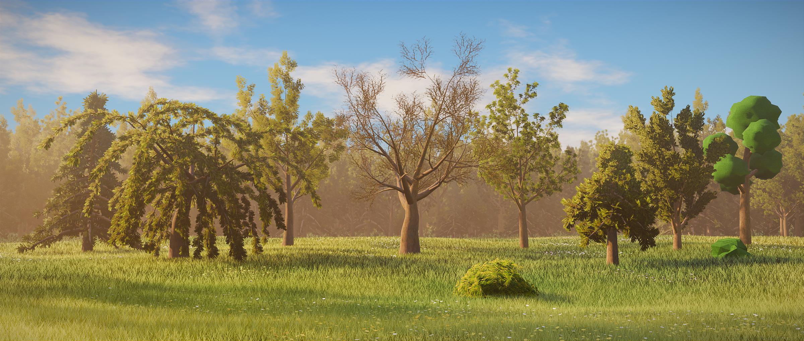
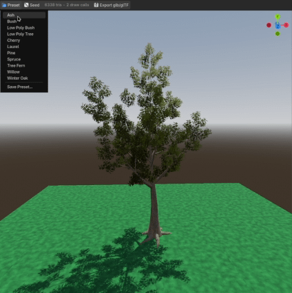
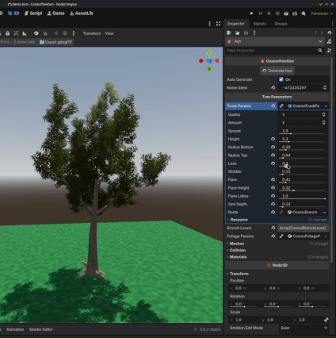
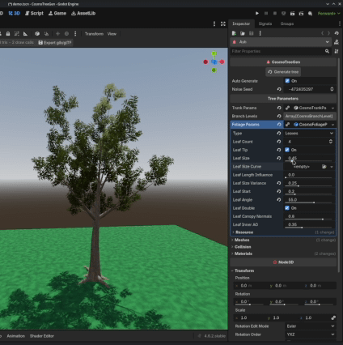
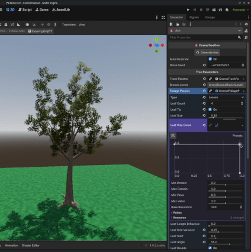

# Cosmo Tree Gen

Procedural tree generator. Work in progress!  

Mainly inspired by Dan Shiffman and EZTree.  

_100% Human made. No AI was or ever will be used in this project._  

## Requirements
Godot 4.4+ required. Developed in 4.6.2.stable.  

## Features
- Procedural tree generator with configurable branch levels.
- All the generation is live and auto-updated in the editor.
- Configurable tree parameters using custom Resources.
	- Multiple trunks per tree.
	- Optional roots.
	- Broken branches by chance.
	- Branch level length and leaf card size by curve.
- Optional flat shading for PSX/PS2 aesthetic.
- Foliage:
	- Icospheres, with configurable subdivisions level.
	- Card leaves, configurable amount and double sided.
- Automatic convex collision generation for the trunk. Optional with a toggle.
	- Pending: optional foliage collision.
- Automatic LOD generation:
	- LOD0, LOD1 and LOD2 MeshInstance3Ds can be generated with customizable ratios and distances.
	- The trunk is simplified and the rest of the tris budget goes to the leaves.
	- Leaf cards are not simplified, fewer and bigger cards are kept instead.
- Save and load tree presets, saved as `CosmoTreePreset` resource.
- Export generated tree as glb/glTF, option to link used materials to the ".import" file.

## Installation
Copy the `addons/cosmo_tree_gen/` folder into your project, enable it.  
You can see some examples and presets in the `demo` folder.  
There's a leaves shader with a simple vertex displacement for wind and mipmap limitation to avoid alpha scissor making all the leaves transparent. 

## Usage
Add a `CosmoTreeGen` node.  
Add `TrunkParams`, `BranchLevels` and `FoliageParams` resources and tweak them.  
Add bark and foliage materials.  
Optionally, toggle `use_collision` for convex collision.  
Optionally, toggle `generate_lod` for LODs.  
Tris budgets and distances can be configured in the project settings: `cosmo_tree_gen/generator`.  
Can be used as is for quick prototyping or exported as glb/glTF. LODs are exported too.  

## Showcase
  
Save and load presets fast.

  
Randomize by seed.

  
Live generation.

  
Curve editor for fine changes.

## TODOs
- Add documentation comments to resources parameters.
- Create documentation page.
- Texture and UV scaling, custom texel density setter.
- Billboard impostor PNG generation for the last LOD.
- More low-poly foliage variations. (Pine, Boxes)
- Graph editor. (Probably not needed)

## References used
Icosphere:
- https://blog.lslabs.dev/posts/generating_icosphere_with_code
- https://schneide.blog/2016/07/15/generating-an-icosphere-in-c/

Trees/branching:
- EZ-Tree author: https://tympanus.net/codrops/2025/01/27/fractals-to-forests-creating-realistic-3d-trees-with-three-js/
- Coding Train / Dan Shiffman: https://www.youtube.com/watch?v=MwLyeEWnMCY
- https://algorithmicbotany.org/
- https://en.wikipedia.org/wiki/L-system

## Assets/Credits
- Leaves: https://opengameart.org/content/60-cc0-vegetation-textures
- Bark: https://ambientcg.com/view?id=Bark014
- Icosphere foliage: Made manually with GIMP.

## LICENSE - MIT License
